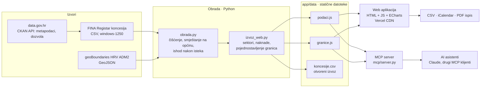

# Tehnička arhitektura – Koncesijski sat

## Pregled

Koncesijski sat je **statična web aplikacija s jednokratnom obradom podataka**. Nema aplikacijskog poslužitelja, baze ni korisničkih računa, pa nema troškova poslužitelja ni osobnih podataka korisnika. Sigurnosna površina je minimalna, a aplikacija se može postaviti na bilo koji statični hosting, uključujući infrastrukturu tijela javnog sektora.

## Komponente

| Komponenta | Tehnologija | Opis |
|---|---|---|
| `izvori.py` | Python, CKAN Action API | Za svaki izvor dohvaća metapodatke s Portala (izdavatelj, dozvola, datum izmjene, resursi). Upozorava ako je lokalna kopija zastarjela. |
| `obrada.py` | Python, pandas, RapidFuzz | Učitava CSV, uklanja duplikate i parsira datume. Ugovor smješta na općinu iz polja LOKACIJA ili naziva davatelja, uz normalizaciju i usporedbu sličnosti (≥ 88 %). Za svaki ugovor istekao prije više od 12 mjeseci određuje ishod: obnovljena, zamjena ili bez nastavka. |
| `izvoz_web.py` | Python (standardna biblioteka) | Grupira oko 150 vrsta koncesija u 11 sektora i spaja ugovorenu godišnju fiksnu naknadu. Pojednostavljuje granice (Douglas-Peucker, ~100 m, 19 MB → 0,84 MB). Zapisuje kompaktne podatke (2 MB), otvoreni CSV i kalendar za pretplatu za svaku općinu s aktivnim ugovorima (477 datoteka `.ics`). |
| `app/` | HTML, CSS, JavaScript bez build koraka, Apache ECharts | Četiri ekrana (karta, što ističe, profil općine, metodologija) i usmjeravanje preko `#hash`, pa se svaki prikaz može podijeliti poveznicom. Status ugovora računa se u pregledniku prema današnjem datumu. |
| `mcp/server.py` | Python (standardna biblioteka), MCP preko JSON-RPC 2.0 / stdio | Četiri alata nad istim podacima, za AI asistente. |
| Hosting | Vercel (statični CDN), GitHub | Svaki push na `main` objavljuje `app/`. |

## Tok podataka i model

Jedan ugovor ima ova polja: davatelj, koncesionar, vrsta → sektor, općina (geoBoundaries `shapeID`), lokacija, početak, istek, ishod nakon isteka (`obnovljena` / `zamjena` / `bez_nastavka`) i godišnja fiksna naknada (EUR).

- **Ishod nakon isteka:**
  - Gledaju se ugovori istog davatelja, iste vrste i iste lokacije.
  - Novi ugovor mora početi između mjesec dana prije i 12 mjeseci nakon isteka.
  - Ako je novi ugovor sklopio isti koncesionar (po OIB-u), ishod je „obnovljena“, inače „zamjena“. Ako takvog ugovora nema, ishod je „bez nastavka“.
- **Zdravstvo** je isključeno jer su te koncesije ukinute zakonom.
- **Naknada:** ključ za spajanje je (OIB davatelja, OIB koncesionara, lokacija, početak, istek). Spojeno je 21.523 od 21.836 ugovora s fiksnom naknadom.

## Standardi i interoperabilnost

| Standard | Gdje |
|---|---|
| CKAN Action API (DCAT metapodaci Portala) | Provjera izvora (`izvori.py`) |
| GeoJSON (RFC 7946), WGS 84 | Granice općina |
| CSV (RFC 4180), UTF-8 | Otvoreni izvoz `koncesije.csv`, izvoz tablica iz aplikacije |
| iCalendar (RFC 5545), webcal | Pretplata na rokove po općini (statični feed, `REFRESH-INTERVAL` 1 dan) i jednokratno preuzimanje rokova (Outlook, Google, Apple) |
| Model Context Protocol / JSON-RPC 2.0 | AI asistenti |
| ISO 8601 datumi, OIB kao ključ subjekta | Svi izlazi |
| WCAG 2.1 (smjernice) | Kontrast, fokus, `aria` opisi grafova, tablični prikaz istih podataka |

## Integracijski potencijal

Uz manje prilagodbe rješenje se može povezati s postojećim javnim sustavima:

1. **Registar koncesija (FINA / MFIN).** Najprirodniji dom: ekran „Što ističe“ i profil općine kao javni pregled ili interni alat za davatelje. Postojeći izvoz registra može se izravno čitati, bez promjene sheme.
2. **Portal otvorenih podataka.** `koncesije.csv` (obogaćen općinom, sektorom, ishodom i naknadom) može se objaviti kao izvedeni skup ili primjer ponovne uporabe.
3. **Elektronički oglasnik javne nabave (EOJN RH).** Spajanje po davatelju i vrsti pokazalo bi je li za ugovor koji uskoro ističe natječaj već objavljen.
4. **Sudski registar i Registar obveznika (OIB).** Status koncesionara, npr. tvrtka u likvidaciji koja još drži koncesiju.
5. **Sustavi općina (pisarnica, kalendari).** Već sada preko pretplate na kalendar (Microsoft 365, Google Workspace) i CSV izvoza, bez ikakve integracije na strani općine. Kalendar je i najjednostavniji kanal obavijesti: ne traži bazu korisnika ni e-adrese.
6. **AI asistenti u upravi.** Preko MCP-a: službenik pita običnim jezikom i dobije odgovor s izvorom.

## Preduvjeti

**Tehnički**
- Statični hosting s HTTPS-om; za obradu Python 3.10+, `pandas` i `rapidfuzz`.
- **Strojno dostupan izvoz registra.** „Preuzmi sve podatke“ na servisi.fina.hr zaštićen je reCAPTCHA-om, pa se ne može automatski osvježavati. Na Portalu je resurs poveznica na stranicu za pretragu, a ne na datoteku. Za dnevno osvježavanje (npr. GitHub Actions) potreban je izravni CSV ili API.
- Službene granice jedinica lokalne samouprave (DGU) umjesto geoBoundaries, uz ažurnu podjelu otoka Krka i Lošinja na općine.

**Organizacijski**
- Vlasnik rješenja: Ministarstvo financija / FINA (registar) ili MPUDT (Portal).
- Davatelji koncesija trebaju upisivati ugovore i anekse na vrijeme, jer o tome ovisi točnost pokazatelja „bez nastavka“.
- Jasna uputa da je „bez nastavka“ signal za provjeru, a ne utvrđena nepravilnost.

**Pravni**
- Registar koncesija je javan (Zakon o koncesijama, NN 69/17, 107/20), a skup je na Portalu pod Otvorenom dozvolom (NN 67/17), uz obvezu navođenja izvora.
- Među koncesionarima ima obrta, dakle imena fizičkih osoba. Aplikacija i otvoreni izvoz prikazuju samo podatke koji su već javni u registru, bez OIB-a (izvorna datoteka registra u repozitoriju sadrži OIB-e kako ih objavljuje FINA). Daljnje povezivanje (npr. sa Sudskim registrom) treba procjenu u skladu s GDPR-om.
- Aplikacija ne prikuplja osobne podatke korisnika: nema kolačića ni analitike, a lokalno pamti samo zadnju gledanu općinu (`localStorage`).

## Sigurnost i održavanje

- Nema poslužiteljskog koda ni unosa korisnika koji bi se pohranjivao. Svi tekstovi iz registra se escapeaju prije prikaza.
- Ažuriranje: novi `koncesije.txt` → `obrada.py` → `izvoz_web.py` → `git push` (Vercel objavi za ~10 s).
- Veličina: stranica s podacima je oko 4 MB nekomprimirano (≈ 1 MB gzip). Učitava se jednom, a nakon toga je svaki filter trenutan.
