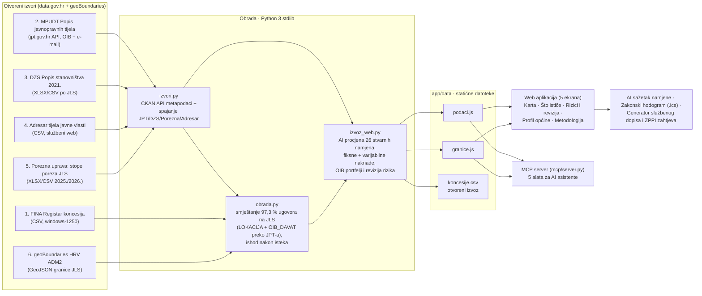

# Tehnička arhitektura – Concessum

## Pregled

Concessum je **statična web aplikacija s višekoračnim cjevovodom povezivanja otvorenih podataka (`data.gov.hr`)**. Nema aplikacijskog poslužitelja, baze ni korisničkih računa, pa nema troškova poslužitelja ni osobnih podataka korisnika. Cijeli cjevovod obrade podataka (`izvori.py`, `obrada.py`, `izvoz_web.py`) i MCP poslužitelj (`mcp/server.py`) napisani su u čistoj standardnoj biblioteci Pythona 3 bez vanjskih ovisnosti.

## Komponente

| Komponenta | Tehnologija | Opis |
|---|---|---|
| `izvori.py` | Python 3 (standardna biblioteka), CKAN Action API | Dohvaća DCAT metapodatke za svih 5 skupova s `data.gov.hr` (`izvori.json`) i gradi povezani registar `otvoreni_izvori.json`: 4.679 javnopravnih tijela po OIB-u (`jpt.gov.hr`), 556/556 JLS-ova s brojem stanovnika (DZS 2021.), službenim webom (Adresar) i stopama poreza na dohodak (Porezna uprava). |
| `obrada.py` | Python 3 (standardna biblioteka: `csv`, `difflib`) | Učitava `koncesije.txt`, uklanja duplikate i parsira datume. Smješta **97,3 % ugovora (24.060 od 24.725)** na općinu/grad koristeći `LOKACIJA`, naziv davatelja i **`OIB_DAVAT` povezan sa sjedištem tijela iz `jpt.gov.hr`** (čime se županijske lučke uprave poput Lučke uprave Senj, Rab ili Crikvenica točno smještaju na matični JLS). Određuje ishod nakon isteka (`obnovljena`, `zamjena`, `bez_nastavka`). |
| `izvoz_web.py` | Python 3 (standardna biblioteka) | Spaja ugovorenu fiksnu godišnju naknadu u EUR (21.523 ugovora) i **varijabilnu naknadu u postotku prihoda ili po jedinici** (8.508 ugovora, stupci 12–15 u `koncesije.txt`). Grupira koncesionare po `OIB_KORIS` u jedinstvene nacionalne portfelje (uz maskiranje OIB-a fizičkih osoba/obrta radi GDPR-a), klasificira svaki ugovor u **26 AI stvarnih namjena** i **15 tipova subjekata**, računa medijane naknada po kategoriji i zastavice rizika, generira kalendare za pretplatu (po općini i davatelju) te pojednostavljuje GeoJSON granice (Douglas-Peucker, 19 MB → 0,84 MB). |
| `app/` | HTML, CSS, JavaScript bez build koraka, Apache ECharts | Pet ekrana (`Karta`, `Što ističe`, `Rizici i revizija`, `Profil općine`, `Metodologija`) + interaktivni modal svakog ugovora (**✨ AI sažetak i procjena stvarne namjene**, **5-koračni zakonski hodogram postupka** s `.ics` izvozom i **generator službenog dopisa / ZPPI zahtjeva**). |
| `mcp/server.py` | Python 3 (standardna biblioteka), MCP preko JSON-RPC 2.0 / stdio | Pet alata (`istjece_uskoro`, `profil_opcine`, `bez_nastavka`, `trazi_koncesionara`, `revizija_rizika`) nad istim obogaćenim podacima za AI asistente. |
| Hosting | Vercel (statični CDN), GitHub | Svaki push na `main` objavljuje `app/`. |

## Tok podataka, AI procjena stvarne namjene i model rizika

Jedan ugovor u `podaci.js` ima kompaktno kodirana polja: davatelj (`OIB_DAVAT`), koncesionar (kanonski indeks grupiran po `OIB_KORIS`), izvorna vrsta → sektor, općina (`shapeID`), lokacija, početak, istek, ishod nakon isteka (`obnovljena` / `zamjena` / `bez_nastavka`), fiksna godišnja naknada (EUR), varijabilna naknada (opis, npr. `+ 2 % prihoda`), **AI stvarna namjena (`namjena_idx`, 26 kategorija)**, **tip subjekta (`tip_s`, 15 kategorija)** i **bitmaska rizika (`rizik_mask`)**.

- **✨ AI procjena stvarne namjene (`namjene`):**
  - U Registru koncesija tisuće su ugovora upisane generičkom vrstom (*„Koncesija na pomorskom dobru“*, *„Koncesija za luku“*).
  - Klasifikator kombinira: (1) djelatnost i ključne riječi u nazivu koncesionara, (2) cjelokupni nacionalni portfelj tog `OIB_KORIS` u RH, (3) vrstu javnopravnog tijela davatelja iz `jpt.gov.hr` (lučka uprava vs. županija/ministarstvo/grad/općina), (4) mikrolokaciju i (5) strukturu naknade.
  - Time razlikuje npr. hotelsku plažu ispred resorta (Valamar, Maistra, Plava Laguna), pomorsku benzinsku postaju (INA), pomorsku agenciju za prihvat kruzera (Elite Travel, Gulliver), uzgajalište bijele ribe i školjaka (Cromaris), podmorske telekomunikacijske i energetske kabele (HT, HEP, Janaf) ili komunalnu odvodnju.
- **Sustav ranog upozorenja i revizije (`rizik_mask`):**
  - `1` (**Cjenovna anomalija**): aktivni ugovor čija je fiksna naknada `< 15 %` medijana iste stvarne namjene u RH (s najmanje 8 usporedivih ugovora u kategoriji) i `< 250 €`, a ugovor **nema** ugovorenu varijabilnu naknadu.
  - `2` (**Dugoročno vezivanje javnog dobra**): trajanje ugovora dulje od 30 godina.
  - `4` (**Bez upisane naknade**): u Registru nije upisana ni fiksna ni varijabilna naknada (izuzimajući dimnjačarske i javne komunalne službe gdje se usluga naplaćuje po cjeniku).
- **Fiskalni rizik JLS-a:**
  - Spajanjem ugovora s DZS Popisom stanovništva 2021. i stopama poreza na dohodak Porezne uprave računa se koliko eura godišnje koncesijske naknade ističe po stanovniku u svakoj općini.

## Standardi i interoperabilnost

| Standard | Gdje |
|---|---|
| CKAN Action API (DCAT metapodaci Portala `data.gov.hr`) | Provjera i dohvat svih 5 izvora (`izvori.py`) |
| OIB (Osobni identifikacijski broj) i JLS šifre | Povezivanje davatelja (`OIB_DAVAT` ↔ `jpt.gov.hr`), grupiranje portfelja koncesionara (`OIB_KORIS`) i spajanje JLS tablica |
| GeoJSON (RFC 7946), WGS 84 | Granice općina i gradova (`opcine.geojson`, `granice.js`) |
| CSV (RFC 4180), UTF-8 | Otvoreni izvoz `koncesije.csv` (obogaćen AI stvarnom namjenom, varijabilnom naknadom i tipom subjekta) |
| iCalendar (RFC 5545), webcal | Pretplata na rokove po općini i po davatelju (statični feed, `REFRESH-INTERVAL` 1 dan) te izvoz 5-koračnog zakonskog hodograma |
| Zakon o koncesijama (NN 69/17, 107/20) & ZPPI (NN 25/13, 85/15, 69/22) | Zakonski hodogram postupka (T-9 mj. do T-1 mj.) i generator Zahtjeva za pristup informacijama |
| Model Context Protocol / JSON-RPC 2.0 | 5 alata za AI asistente (`mcp/server.py`) |
| WCAG 2.1 (smjernice) | Kontrast, fokus, `aria` opisi grafova, tablični prikaz istih podataka |

## Integracijski potencijal

Uz manje prilagodbe rješenje se može povezati s postojećim javnim sustavima:

1. **Registar koncesija (FINA / MFIN).** Najprirodniji dom: ekran „Što ističe“, profil općine i revizija rizika kao javni pregled ili interni alat za davatelje. Postojeći izvoz registra može se izravno čitati, bez promjene sheme.
2. **Portal otvorenih podataka.** `koncesije.csv` (obogaćen općinom, AI stvarnom namjenom, varijabilnom naknadom i ishodom) može se objaviti kao izvedeni skup ili ogledni primjer ponovne uporabe 5 skupova podataka.
3. **Elektronički oglasnik javne nabave (EOJN RH).** Spajanje po davatelju i vrsti pokazalo bi je li za ugovor koji uskoro ističe natječaj već objavljen.
4. **Sudski registar i Registar obveznika (OIB).** Status koncesionara, npr. tvrtka u likvidaciji koja još drži koncesiju.
5. **Sustavi općina (pisarnica, kalendari).** Već sada preko pretplate na kalendar (Microsoft 365, Google Workspace, Apple) i CSV izvoza, bez ikakve integracije na strani općine.
6. **AI asistenti u upravi.** Preko MCP-a: službenik pita običnim jezikom i dobije odgovor s izvorom.

## Preduvjeti

**Tehnički**
- Statični hosting s HTTPS-om; za cjelokupnu obradu dovoljan je Python 3 standardna biblioteka.
- **Strojno dostupan izvoz registra.** „Preuzmi sve podatke“ na servisi.fina.hr zaštićen je reCAPTCHA-om, pa se ne može automatski osvježavati. Na Portalu je resurs poveznica na stranicu za pretragu, a ne na datoteku. Za dnevno osvježavanje (npr. GitHub Actions) potreban je izravni CSV ili API.
- Službene granice jedinica lokalne samouprave (DGU) umjesto geoBoundaries, uz ažurnu podjelu otoka Krka i Lošinja na općine.

**Organizacijski**
- Vlasnik rješenja: Ministarstvo financija / FINA (registar) ili MPUDT (Portal).
- Davatelji koncesija trebaju upisivati ugovore i anekse na vrijeme, jer o tome ovisi točnost pokazatelja „bez nastavka“.
- Jasna uputa da je „bez nastavka“ signal za provjeru, a ne utvrđena nepravilnost.

## Pravni i GDPR okvir

- Registar koncesija i svi povezani skupovi javni su na Portalu otvorenih podataka (`data.gov.hr`) pod Otvorenom dozvolom (NN 67/17), uz obvezu navođenja izvora.
- **Zaštita osobnih podataka (GDPR):** Pri grupiranju portfelja po `OIB_KORIS` u `izvoz_web.py`, OIB se u javnom izvozu (`podaci.js`) zadržava isključivo za pravne osobe (trgovačka društva, javna poduzeća, ustanove), dok se za obrte i fizičke osobe (`tip_s == 14`) OIB automatski uklanja iz klijentskog paketa.
- Aplikacija ne prikuplja osobne podatke korisnika: nema kolačića ni analitike, a lokalno pamti samo zadnju gledanu općinu i temu prikaza (`localStorage`).

## Sigurnost i održavanje

- Nema poslužiteljskog koda ni unosa korisnika koji bi se pohranjivao. Svi tekstovi iz registra se escapeaju prije prikaza.
- Ažuriranje: novi `koncesije.txt` → `obrada.py` → `izvoz_web.py` → `git push` (Vercel objavi za ~10 s).
- Veličina: stranica s podacima je oko 4 MB nekomprimirano (≈ 1 MB gzip). Učitava se jednom, a nakon toga je svaki filter trenutan.
